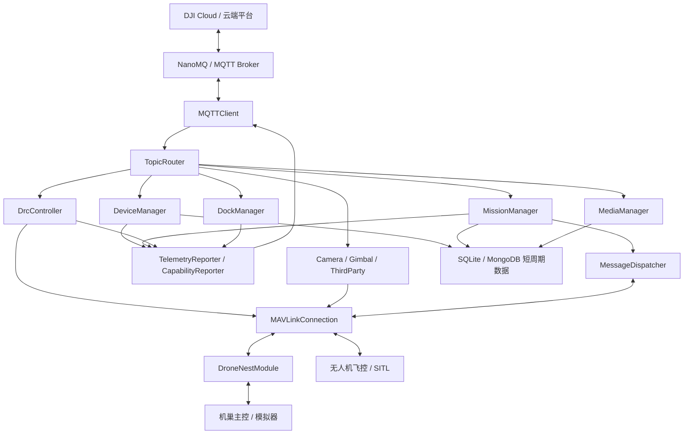

# 当前整体链路与业务流程闭环梳理

更新时间：2026-07-15

本文基于 `docs/业务流程.md`、用户提供的链路示意图、`src/main.py` 当前注册入口、核心业务模块代码和 `docs/DOCK3_MODULE_STATUS.md` 梳理。口径是**当前项目真实实现到哪一步**，不是理想架构说明。

## 1. 图片表达的链路关系

用户图里的链路可以抽象为：

```text
云端平台
  ↓ MQTT / NanoMQ
Edge Gateway 网关
  ↓ 单通道：机巢协议 / MAVLink adapter
机巢主控
  ↓ 内部通道
无人机 / 飞控 / 负载 / 执行器
```

当前项目对应关系：

| 图中对象 | 当前项目落点 | 当前职责 |
|---|---|---|
| 网关 | `src/main.py`, `src/mqtt/`, `src/cloud_api/`, `src/mission/`, `src/device/` | 连接云端 MQTT，路由 Dock3 method，编排任务状态机，映射设备状态，上报 OSD/state/events/HMS |
| 机巢 | `src/modules/drone_nest_module.py`, `src/nest_simulator.py`, `src/generated_dialect/drone_nest.py` | 接收网关命令，执行/模拟舱盖、充电、夹紧、起降许可，回传 12004 状态和 12005 命令结果 |
| 无人机 | `src/core/connection.py`, `src/modules/flight_control.py`, `src/modules/waypoint_manager.py`, `src/modules/telemetry_module.py` | 飞控 MAVLink 连接、模式切换、解锁、航点、遥测、任务进度 |
| 负载/相机/云台 | `src/payload/`, `src/media/`, `src/drc/` | 相机拍照录像、云台控制、直播、媒体、DRC 下的负载控制 |

图中的决策逻辑在当前项目里基本成立：

- 网关发给机巢的如果是飞行命令，机巢/网关再转成飞控动作或任务状态推进。
- 网关发给机巢的如果是机巢命令，机巢自己执行开盖、关盖、充电、夹紧、急停等动作。
- 网关做状态查询时，机巢/飞控状态会被网关整合后上报云端。
- 无人机发出的遥测、航点进度、飞行模式等状态，最终由网关转成 Dock3 OSD/state/progress。

## 2. 当前总架构



`src/main.py` 里当前实际初始化的业务模块包括：

- 云端链路：`MQTTClient`、`TopicRouter`、`CloudConnectionManager`、`TelemetryReporter`、`CapabilityReporter`
- 设备/组织/属性：`DeviceManager`
- 任务/航线：`MissionManager`
- 飞控：`FlightControl`、`ModeControl`、`WaypointManager`、`TelemetryModule`
- 机巢：`DroneNestModule`、独立 `nest_mavlink` 链路
- DRC：`DrcController`
- 机场/CMD：`DockManager`
- 负载：`CameraController`、`GimbalController`、`ThirdPartyController`
- 媒体/直播：`MediaManager`
- 日志/运维：`LogManager`
- 飞安/P2：`FlySafeManager`、`FlightAreaManager`、`CustomDataManager`、`RTKModule`
- 数据：`DataRetentionManager`、`CloudSyncManager`，数据库后端支持 SQLite / MongoDB
- 全局状态：`GatewayEventReducer`、`CommandAdmissionEngine`

## 3. 云端下行链路

当前下行处理路径：

```text
云端 MQTT
  → NanoMQ
  → MQTTClient._on_message
  → TopicRouter.route(method)
  → 业务模块 handler
  → 设备侧 adapter / MAVLink / 本地状态机
  → services_reply / property_set_reply / drc/up / status_reply
```

`src/main.py` 当前按分类注册了大量 method，覆盖这些主类：

| 分类 | 当前注册入口 | 当前状态 |
|---|---|---|
| device | `ota_create`, `config_update`, `property_set`, `property_get`, `device_binding`, `update_topo`, `hms_get`, `device_log_upload`, `cover_open`, `charge_open` 等 | P0/P1 主体已接 Dock3 回包，真实 OTA/真实设备动作仍需 adapter |
| mission / wayline | `flighttask_prepare`, `flighttask_execute`, `flighttask_undo`, `flighttask_pause`, `flighttask_resume`, `return_home_cancel`, `one_key_takeoff_flow` 等 | 航线和一键启航闭环已可验证，真实完整航线终态仍待补证据 |
| payload | `camera_photo_take`, `camera_recording_start`, `camera_focal_length_set`, `gimbal_rotate`, `payload_capability_query` 等 | MQTT/SITL 控制闭环已通过，真实 Payload SDK ACK 未接 |
| media / live | `file_list_get`, `file_delete`, `live_start`, `live_stop`, `live_capability_query`, `live_set_quality` 等 | 本地媒体和 mock live 已通过，真实 OSS/推流未接 |
| drc | `drc_mode_enter`, `drc_speed_push`, `fly_to_point_update`, `takeoff_to_point`, `stick_control` 等 | DRC 基础、心跳、指点飞行已通过专项 |
| dock / cmd | `dock_control`, `dock_status_query`, `dock_emergency_stop`, `dock_reset` 等 | 与机巢命令映射已接，真实耗时动作需实机验证 |
| log | `fileupload_list`, `fileupload_start`, `fileupload_update` | 本地日志扫描/上传事件已接，生产对象存储未完整接 |
| flysafe / flight_area / custom_data | `unlock_license_*`, `flight_areas_*`, `custom_data_transmission_*` | 有入口，主要属于 P2/待迁移/占位 |

## 4. 设备上行链路

当前上行处理路径：

```text
无人机飞控 / 机巢主控
  → MAVLinkConnection
  → MessageDispatcher
  → TelemetryModule / FlightControl / DroneNestModule
  → DeviceManager / MissionManager / DockManager
  → TelemetryReporter / MQTTClient
  → 云端 OSD / state / events / hms / status
```

已实现的上行能力：

- 飞控遥测进入 `TelemetryModule`，再由 `TelemetryReporter` 上报 OSD/state。
- 子设备在线时，网关同时能发 dock OSD 和 drone OSD。
- 机巢 12004 状态进入 `DroneNestModule._handle_nest_response()`，解析为舱盖、充电、夹紧、急停、ready/busy/fault、心跳等字段。
- 机巢状态通过回调同步到：
  - `DeviceManager.update_from_nest()`：转 Dock3 properties/HMS/operation
  - `DockManager.update_dock_status()`：更新 dock 状态查询缓存
  - `FlightControl.handle_nest_environment_from_callback()`：推进一键启航/起飞许可
- 命令结果 12005 通过 `command_result_callbacks` 回到 Dock/CMD 业务层，上报 operation 结果。

## 5. 当前业务闭环

### 5.1 启动和上线闭环

```text
start.sh / python main.py
  → load_config
  → configure_database
  → init MQTT / TopicRouter
  → init Device/Mission/DRC/Dock/Media/Payload
  → init CloudConnectionManager / TelemetryReporter
  → register handlers
  → connect MQTT
  → connect MAVLink / nest_mavlink
  → report online / capabilities / topology
  → start heartbeat / OSD / retention / cloud sync
```

当前状态：已通过 Ubuntu 纯模拟基础链路，E2E 全链路脚本已能串联 11 段业务。

### 5.2 设备绑定、拓扑和属性闭环

```text
云端查询/绑定/解绑
  → DeviceManager
  → 本地绑定缓存/数据库
  → update_topo status 上报
  → status_reply 回执处理

云端 property_set / property_get
  → DeviceManager 校验 Dock3 字段
  → 更新本地物模型/配置
  → property_set_reply / state 上报
```

当前状态：

- 设备上线/心跳、组织绑定、`update_topo`、多设备拓扑、解绑/离线均已有专项或 E2E 证据。
- `domain/type/sub_type` 等真实云端枚举还需最终精校。

### 5.3 遥测、OSD、State 闭环

```text
飞控 MAVLink 遥测
  → TelemetryModule / TelemetryProcessor
  → DeviceManager.update_from_telemetry
  → build_dock3_dock_osd
  → TelemetryReporter.report_osd
  → thing/product/{sn}/osd

关键属性变化
  → DeviceManager / MissionManager / DRC / Dock
  → TelemetryReporter.report_state
  → thing/product/{sn}/state
```

当前状态：

- OSD/state 结构、字段隔离、错误样本过滤已通过专项。
- 最新状态文档仍提示：部分严格样本的 aircraft 经纬度、电池、GPS 可能为 0，说明协议结构已通过，但真实动态遥测仍要继续用 SITL/真机留证。

### 5.4 机巢控制闭环

```text
云端 cmd / dock_control
  → DockManager / DeviceManager
  → GCSCommand 映射
  → DroneNestModule.send_gcs_command
  → MAVLink 自定义 12003
  → 机巢执行开盖/关盖/充电/夹紧/急停
  → 机巢 12005 回复
  → operation result / events / services_reply
```

当前状态：

- 12003/12004/12005、自定义 dialect、命令字、健康待命位、UDP 首包注册、命令结果回调已有实现。
- 7 类机巢故障注入已能进入 HMS、OSD、dock_operation 和 MongoDB 操作记录。
- 真实机巢耗时动作、真实拒绝原因、真实故障恢复仍未完整实机闭环。

### 5.5 航线和一键启航闭环

```text
flighttask_prepare
  → 下载/解析 KMZ/WPML/KML 或 mock 文件
  → 写入 mission/waypoint
  → 上传 MAVLink mission 或委托机巢
  → flighttask_ready / progress

flighttask_execute
  → 校验 flight_id
  → 预留 mission monitor
  → 解锁门禁 / set AUTO
  → request_takeoff 给机巢
  → progress 上报
  → pause/resume/return/undo
  → 完成/取消/失败事件
```

当前状态：

- `MissionManager.handle_flighttask_execute()` 已接真实飞控执行路径：检查任务 ID、启动任务监控、确保解锁、切 AUTO、请求机巢起飞、上报 progress。
- Wayline 基础闭环已通过；真实 `HD.kml` 已验证到 `MISSION_CURRENT=2`、20% 进度。
- 一键启航离线闭环和全链路 E2E 已通过。
- 尚缺完整航线终态、返航/降落/上锁、媒体计数和完成事件字段的强证据。

### 5.6 DRC 实时控制闭环

```text
drc_mode_enter
  → 安全检查 / 状态同步
  → 切 GUIDED
  → 上报 drc_state

drc/down 心跳/杆量/速度/指点
  → DrcController 校验
  → MAVLink SET_POSITION_TARGET / COMMAND
  → 飞控执行
  → 超时自动退出
```

当前状态：

- `drc_mode_enter/exit`、官方心跳、杆量、速度控制、`takeoff_to_point`、`fly_to_point_update/stop`、非法值拒绝已通过专项。
- 仍需继续精校链路抖动、超时边界、真实 MAVLink type_mask/坐标系/航向高度行为。

### 5.7 媒体、直播、相机云台闭环

```text
媒体：
file_list_get / file_delete / adjust_upload_priority
  → MediaManager 本地目录扫描/状态更新
  → media reply / upload event

直播：
live_start / live_stop / live_set_quality
  → MediaManager
  → mock:// 或 ffmpeg 推流入口
  → live_status_notify

相机云台：
camera_* / gimbal_*
  → CameraController / GimbalController / DRC payload
  → MAVLink/SITL 或本地状态
  → reply / 状态回读
```

当前状态：

- 媒体基础、直播 mock、相机/云台 MQTT/SITL 控制专项已通过。
- 真实 OSS 凭证、断点续传、真实 RTMP/WebRTC/GB28181、真实 Payload SDK/硬件 ACK 未完成。

### 5.8 HMS、日志、配置、固件闭环

```text
HMS：
机巢/飞控故障
  → nest_hms_mapper / DeviceManager
  → alarm DB
  → hms events / hms_get / hms_clear

日志：
device_log_list_get / fileupload_*
  → LogManager / DeviceManager
  → 本地日志扫描
  → 上传进度事件

配置/固件：
config_update / config_rollback / ota_create / ota_cancel
  → DeviceManager
  → 本地配置持久化 / mock OTA 状态机
  → progress/result events
```

当前状态：

- HMS/log、firmware/config 专项已通过。
- 当前 OTA 是 mock；真实下载、MD5、刷写、备份、回滚未接。
- 生产对象存储签名上传、日志压缩、多文件打包还未完整实现。

## 6. 当前完成度判断

以 `docs/DOCK3_MODULE_STATUS.md` 为最新口径：

| 业务域 | 当前判断 | 说明 |
|---|---|---|
| MQTT topic/reply | 已通过 | services、property/set_reply、requests_reply、status_reply、drc/up 已分流 |
| 设备上线/绑定/拓扑 | 已通过 | 单设备、多子设备、解绑、离线、重连已有专项 |
| Properties / OSD / State | 部分通过 | 协议结构已通过，真实动态遥测字段还要继续留证 |
| CMD / 机巢基础控制 | 已通过/部分完成 | 云端 CMD 和机巢模拟链路可用，真机耗时动作未闭环 |
| Wayline / 一键启航 | 已通过/部分完成 | 基础执行和 E2E 已通过，完整真实航线终态待补 |
| DRC | 已通过 | 基础链路、心跳、指点飞行、非法值拒绝已覆盖 |
| 媒体 | 已通过 | 本地扫描和上传事件可用，真实 OSS 未接 |
| Live | 已通过 | mock live 可用，真实推流未接 |
| 相机/云台 | 已通过/部分完成 | MAVLink/SITL 控制闭环可用，真实硬件 ACK 未接 |
| HMS/log | 已通过/部分通过 | 查询、清除、事件、日志列表/上传进度可用，生产上传待补 |
| Firmware/config | 已通过 | 配置闭环可用；固件是 mock OTA |
| 数据保留/MongoDB | 部分完成 | 代码已接 MongoDB，仍需 Ubuntu 实库审计和压测 |
| FlySafe/FlightArea/CustomData/PSDK/AirSense | 待迁移/暂缓 | 有入口或占位，不阻塞 P0/P1 主链路 |

整体结论：

- **网关侧 Dock3 云端协议闭环：基本完成。**
- **Ubuntu 纯模拟 + SITL 联调基线：已能跑 11 段 P0/P1 E2E。**
- **真实设备全量接入：未完成，主要差真实机巢、真实飞控完整终态、真实 Payload、真实 OSS、真实推流、真实 OTA adapter。**

## 7. 当前最关键缺口

按优先级建议继续推进：

1. **机巢真实状态机**
   - 真实开盖/关盖/充电/夹紧耗时。
   - 真实拒绝原因和故障恢复。
   - 实体机巢日志、HMS、operation record 留证。

2. **飞控真实完整任务终态**
   - SITL/真机完整航线执行到终点。
   - 返航、降落、上锁、任务完成事件。
   - `set_flight_mode` 模式映射专项复测。

3. **真实媒体/直播/负载 adapter**
   - OSS 上传、断点续传、上传完成事件。
   - RTMP/WebRTC/GB28181 实际推流。
   - 相机变焦、对焦、拍照录像、云台控制的真实硬件 ACK。

4. **真实 OTA adapter**
   - 固件下载、MD5 校验、备份、刷写、回滚。
   - 升级失败码和操作记录。

5. **生产化和非阻塞**
   - MongoDB 实库审计。
   - 文件/上传/DB/固件任务后台化压测。
   - 生产 TLS/鉴权/桥接策略。

6. **P2 高级能力**
   - Custom Fly Region。
   - FlySafe 解禁证书。
   - PSDK/ESDK 透传。
   - AirSense、高级飞安、高级负载。

## 8. 当前验收脚本入口

当前可用作证据的主要脚本：

| 验收域 | 脚本 |
|---|---|
| P0 批量 | `python tools/mqtt_dock3_p0_batch_test.py --timeout 12` |
| Properties | `python tools/mqtt_dock3_properties_test.py --timeout 12 --quiet-stale` |
| OSD/state | `python tools/mqtt_dock3_osd_state_test.py --timeout 15 --quiet-stale` |
| Device topology | `python tools/mqtt_dock3_device_test.py --timeout 12 --quiet-stale` |
| Organization | `python tools/mqtt_organization_test.py --config config/gateway.yaml --action full ...` |
| CMD | `python tools/mqtt_dock3_cmd_test.py --timeout 12 --quiet-stale` |
| DRC | `python tools/mqtt_dock3_drc_test.py --timeout 12 --quiet-stale --osd-wait 6` |
| Wayline | `python tools/mqtt_dock3_wayline_test.py --timeout 12 --quiet-stale` |
| 一键启航 | `python tools/e2e_takeoff_flow_test.py --timeout 12` |
| Media | `python tools/mqtt_dock3_media_test.py --timeout 12 --quiet-stale` |
| Live | `python tools/mqtt_dock3_live_test.py --timeout 12 --quiet-stale` |
| HMS/log | `python tools/mqtt_dock3_hms_log_test.py --timeout 20 --quiet-stale` |
| Firmware/config | `python tools/mqtt_dock3_firmware_config_test.py --timeout 20 --quiet-stale` |
| 机巢 v1.3 | `python tools/nest_v13_protocol_test.py --verbose` |
| 全链路 | `python tools/e2e_full_chain_test.py --timeout 20 --quiet-stale --fail-on-stale --continue-on-fail` |

## 9. 最终一句话

当前项目已经不是“只有架构图”的阶段，而是已经形成了**云端 Dock3 MQTT -> 网关业务模块 -> 机巢/飞控/负载 adapter -> OSD/state/events/HMS 回云端**的主链路。P0/P1 在模拟/SITL 口径下基本可跑通，下一阶段重点不是新增大业务模块，而是把关键模拟链路逐步替换成真实设备 adapter，并补齐真实链路证据。
