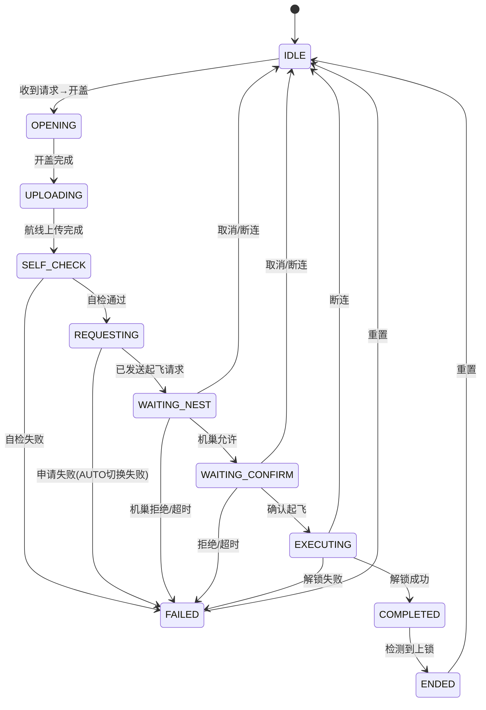

# Edge Gateway边云协同网关业务流程

## 一、整体架构概览

┌─────────────────────────────────────────────────────────────────────────┐
│                           系统架构全景图                                  │
└─────────────────────────────────────────────────────────────────────────┘


                              ┌─────────────────┐
                              │   DJI Cloud     │
                              │   (云端控制平台) │
                              └────────┬────────┘
                                       │ MQTT TLS 8883
                                       ▼
                              ┌─────────────────┐
                              │    NanoMQ       │
                              │  (本地Broker)   │
                              │ TCP 1883 / WS 8083 │
                              └────────┬────────┘
                                       │ paho-mqtt
                                       ▼
┌─────────────────────────────────────────────────────────────────────────┐
│                    Edge Gateway (树莓派)                               │
│                                                                       │
│  ┌─────────────────────────────────────────────────────────────────┐  │
│  │ 1. 入口与配置层                                                │  │
│  │  main.py  │  gateway.yaml  │  Config(单例)                     │  │
│  └─────────────────────────────────────────────────────────────────┘  │
│                                    │                                  │
│  ┌─────────────────────────────────────────────────────────────────┐  │
│  │ 2. 云端协议层                                                  │  │
│  │  MQTTClient  │  TopicRouter  │  MessageBuilder                │  │
│  │  CloudConnectionManager  │  TelemetryReporter                 │  │
│  └─────────────────────────────────────────────────────────────────┘  │
│                                    │                                  │
│  ┌─────────────────────────────────────────────────────────────────┐  │
│  │ 3. 业务服务层                                                  │  │
│  │  ┌──────────┐ ┌──────────┐ ┌──────────┐ ┌──────────┐          │  │
│  │  │DeviceMgr │ │MissionMgr│ │DrcCtrl   │ │MediaMgr  │          │  │
│  │  │CameraCtrl│ │GimbalCtrl│ │DockMgr   │ │ThirdParty│          │  │
│  │  └──────────┘ └──────────┘ └──────────┘ └──────────┘          │  │
│  └─────────────────────────────────────────────────────────────────┘  │
│                                    │                                  │
│  ┌─────────────────────────────────────────────────────────────────┐  │
│  │ 4. 功能模块层                                                  │  │
│  │  ┌──────────┐ ┌──────────┐ ┌──────────┐ ┌──────────┐          │  │
│  │  │FlightCtrl│ │WaypointMgr││NestModule││Telemetry │          │  │
│  │  │ModeCtrl  │ │RTKModule │ │GimbalCtrl││FlySafe   │          │  │
│  │  └──────────┘ └──────────┘ └──────────┘ └──────────┘          │  │
│  └─────────────────────────────────────────────────────────────────┘  │
│                                    │                                  │
│  ┌─────────────────────────────────────────────────────────────────┐  │
│  │ 5. 核心框架层                                                  │  │
│  │  MessageDispatcher  │  MAVLinkConnection  │  MessageCache      │  │
│  │  Observer(观察者模式)                                           │  │
│  └─────────────────────────────────────────────────────────────────┘  │
│                                    │                                  │
│  ┌─────────────────────────────────────────────────────────────────┐  │
│  │ 6. 协议与数据层                                                │  │
│  │  GCSOrderCodec │ 自定义MAVLink方言 │ SQLAlchemy ORM             │  │
│  │  SQLite数据库  │ 数据保留管理器    │                             │  │
│  └─────────────────────────────────────────────────────────────────┘  │
└─────────────────────────────────────────────────────────────────────────┘
                                       │ MAVLink (Serial/UDP/TCP)
                                       ▼
                    ┌───────────────────┴───────────────────┐
                    │                                       │
                    ▼                                       ▼
            ┌───────────────┐                       ┌───────────────┐
            │    无人机      │                       │    机巢        │
            │  (ArduPilot/  │                       │   (PLC/HW)    │
            │    PX4)       │                       │  Controller   │
            └───────────────┘                       └───────────────┘
                    │                                       │
                    ▼                                       ▼
            ┌───────────────┐                       ┌───────────────┐
            │   相机/云台    │                       │  环境传感器    │
            │   第三方负载   │                       │  充电系统      │
            └───────────────┘                       └───────────────┘

---

## 二、系统启动流程

### 2.1 系统启动时序

start.sh → venv → NanoMQ → python main.py → Config.load() → EdgeGateway.initialize() → start() → run()

### 2.2 系统初始化阶段

| 步骤 | 组件 | 职责 |
|------|------|------|
| 1 | Config | 加载 gateway.yaml 配置文件，提供全局配置访问 |
| 2 | Logger | 初始化日志系统，配置日志级别和输出路径 |
| 3 | MQTTClient | 连接本地 NanoMQ Broker |
| 4 | TopicRouter | 创建消息路由，注册约165个API处理器 |
| 5 | Business Modules | 初始化设备管理、任务管理、相机控制、云台控制等业务模块 |
| 6 | CloudConnectionManager | 初始化云端连接管理 |

### 2.3 启动阶段

| 步骤 | 组件 | 职责 |
|------|------|------|
| 1 | EventLoop | 获取或创建异步事件循环 |
| 2 | MAVLinkConnection | 根据配置建立与飞控的串行/UDP/TCP连接 |
| 3 | MessageDispatcher | 创建消息分发器，注册功能模块 |
| 4 | Module Injection | 注入模块依赖（FlightControl → MissionManager等） |
| 5 | CloudConnectionManager | 上报设备在线状态，启动10秒心跳 |
| 6 | DeviceManager | 自动查询绑定状态 |

### 2.4 模块依赖注入关系
```
MissionManager
  ├── FlightControl       — 飞行模式切换、解锁、起飞、RTL
  ├── ModeControl         — GUIDED模式、goto位置
  ├── WaypointManager     — 航线上传/下载/验证/进度
  ├── DroneNestModule     — 开门/关门/充电/停机
  ├── TelemetryModule     — 获取实时高度用于着陆检测
  ├── TelemetryReporter   — 上报OSD/进度/结果/异常
  ├── MAVLinkConnection   — 直接发送MAVLink命令(commmand_long等)
  └── Database            — 航线持久化(MissionDB, WaypointDB)

消息分发器启动
  → 将所有功能模块注册到分发器（飞行控制、遥测采集、机巢管理、航点管理等）
  → 为每个模块注册感兴趣的消息类型（如飞行控制监听HEARTBEAT、COMMAND_ACK）
  → 遥测模块订阅所有消息（通配符*），实时采集飞行数据
  → 启动两个核心线程：
    - 消息接收线程（接收MAVLink消息 → 解析 → 分发到各模块）
    - 空闲任务线程（心跳超时检查、周期性任务轮询）
```
### 2.5 云端上线

MQTT连接确认成功
  → 上报设备在线状态到云端
  → 上报设备基本信息（固件版本、产品型号、硬件版本）
  → 上报完整能力集（机场能力、无人机能力、负载能力、媒体能力、DRC能力）
  → 启动云端心跳保活（每10秒一次）
  → 自动查询设备绑定状态（判断是否已绑定到组织/工作空间）
  → [已绑定] 上报设备拓扑信息（子设备列表）
  → 启动OSD定频推送线程（每1秒上报一次飞行数据）
  → 启动系统状态定时更新线程（每5秒查询存储、网络等状态）
  → 启动数据保留清理任务（定期清理过期遥测/告警数据）
  → 启动云端同步任务（将本地数据同步到云端）

## 三、设备管理流程

### 3.1 设备绑定流程

设备首次上电
  → 自动连接MQTT Broker
  → 上报设备上线事件
  → 自动向云端查询绑定状态
    → [云端回复：未绑定] 等待用户在云端平台操作
      → 用户在云端输入设备SN和绑定码
      → 云端下发绑定指令到设备
      → 设备记录工作空间ID、组织信息
      → 保存绑定信息到本地文件 + 数据库
      → 上报绑定成功事件
      → 上报设备拓扑信息（子设备SN、类型、在线状态）
    → [云端回复：已绑定] 直接进入在线状态
      → 恢复上次的组织/工作空间信息
      → 上报设备拓扑

请求通道: requests → requests_reply 事件上报: events (device_binding)

### 3.2 属性管理流程

云端下发 property_set → TopicRouter 路由 → DeviceManager.handle_property_set → 解析属性类型 → 更新物模型 → 触发状态回调 → MQTT状态上报

支持属性: 95+，包括固件版本、存储容量、飞行限制、安全设置等

### 3.3 OTA 固件升级流程

云端下发 ota_create → DeviceManager.handle_ota_create → 验证固件包 → 备份当前固件 → 写入新固件 → 校验完整性 → 标记升级状态 → 触发重启 → 上报升级结果

### 3.4 HMS 告警处理流程

MAVLink 告警消息 → TelemetryModule 解析 → DeviceManager.handle_hms_get → 转换为 DJI 标准告警格式 → 存储到数据库 → MQTT事件上报

---

## 四、飞行任务流程

### 4.1 概述

`[src/mission/manager.py](src/mission/manager.py)` 是整个系统中 **最核心的业务模块**，负责无人机航线任务的完整生命周期管理。代码量1420行。

### 4.2 任务状态机


## 4.3完整流程与失败处理

```
  ┌──────────────┐
  │   IDLE 🟢    │◀─────────────────────────────┐
  └──────┬───────┘                              │
         │ 收到请求                              │
         ▼                                      │
  ┌──────────────┐                              │
  │  🚪 开盖      │──失败──┐                    │
  └──────┬───────┘        │                    │
         ▼                │                    │
  ┌──────────────┐        │                    │
  │  🗺️ 上传航线  │──失败──┤                    │
  └──────┬───────┘        │                    │
         ▼                │                    │
  ┌──────────────┐        │                    │
  │  🔬 自检      │──超时──┤                    │
  └──────┬───────┘        │                    │
         ▼                │                    │
  ┌──────────────┐        │   ┌───────────┐   │
  │  🚀 申请起飞  │──失败──┼──▶│  🔄 重试   │───┘
  └──────┬───────┘        │   │ 返回错误   │
         ▼                │   │ 重新发起   │
  ┌──────────────┐        │   └───────────┘
  │  ⏳ 等待机巢  │──拒绝──┤
  └──────┬───────┘  /超时  │
         ▼                │
  ┌──────────────┐        │   ┌───────────┐
  │  👤 等待确认  │──拒绝──┼──▶│  🛑 取消   │──▶ 关闭机巢 → IDLE
  └──────┬───────┘  /超时  │   │ TAKEOFF_  │
         ▼                │   │ ABORT     │
  ┌──────────────┐        │   └───────────┘
  │  🔑 执行起飞  │──超时──┘
  │  循环arm 10s  │
  └──────┬───────┘
         │ 解锁成功
         ▼
  ┌──────────────┐     ┌──────────┐
  │  ✅ 起飞成功  │────▶│ 🏠 返航   │──▶ 降落 → 上锁 → ENDED 🏁
  │  ✈️ 执行航线  │     │ RTL/QRTL │
  └──────────────┘     └──────────┘
```
## 4.4失败处理决策

| 时机 | 失败原因 | 选项A：重试 🔄 | 选项B：取消任务 🛑 |
|------|----------|---------------|-------------------|
| **起飞前** | 开盖失败 | 修复后重新发起 | 发TAKEOFF_ABORT关巢→IDLE |
| | 上传航线失败 | 修复后重新发起 | 发TAKEOFF_ABORT关巢→IDLE |
| | 自检超时 | 修复后重新发起 | 发TAKEOFF_ABORT关巢→IDLE |
| | AUTO切换失败 | 修复后重新发起 | 发TAKEOFF_ABORT关巢→IDLE |
| | 机巢拒绝/超时 | 修复后重新发起 | 发TAKEOFF_ABORT关巢→IDLE |
| | 用户拒绝/确认超时 | 修复后重新发起 | 发TAKEOFF_ABORT关巢→IDLE |
| | 解锁超时 | 修复后重新发起 | 发TAKEOFF_ABORT关巢→IDLE |
| | 取消/断连 | — | 发TAKEOFF_ABORT关巢→IDLE |
| **起飞后** | 取消任务 | — | 先返航→降落→上锁→ENDED |

---

#### 4.5 断点续飞机制

```
保存断点:
  文件位置: /tmp/breakpoint.json
  内容: {task_id, last_waypoint_idx, total_waypoints}
  触发时机: 监控循环每次检测到航点变化

恢复流程 (handle_flighttask_recovery):
  1. _load_breakpoint() 读取断点
  2. 从数据库加载完整航线
  3. upload_mission() 上传至FC
  4. set_current_waypoint(断点索引)
  5. 启动监控线程继续执行
  6. _clear_breakpoint() 清除断点文件
```
第一步：存档——暂停任务，飞机返航
                    飞行中的飞机
                          │
                          ▼
              ┌───────────────────────┐
              │   执行航线任务中       │
              │   (AUTO模式)          │
              │   当前航点: 第5个      │
              └──────────┬────────────┘
                         │
                    收到暂停指令
                         │
                         ▼
              ┌───────────────────────┐
              │   1. 记录断点位置     │
              │      _breakpoint_idx=5│
              │   2. 切换RTL模式      │
              │   3. 飞机飞回机巢     │
              └──────────┬────────────┘
                         │
                         ▼
              ┌───────────────────────┐
              │   飞机降落回机巢      │
              │   机巢关舱门          │
              │   断点保留在内存中    │
              └───────────────────────┘
---
第二步：读档——恢复任务，从断点继续
                    停在机巢的飞机
                          │
                          ▼
              ┌───────────────────────┐
              │   IDLE状态            │
              │   保留断点: 第5个航点  │
              └──────────┬────────────┘
                         │
                    收到恢复指令
                         │
                         ▼
              ┌───────────────────────┐
              │   机巢准备            │
              │   1. 打开舱门         │
              │   2. 释放夹紧         │
              │   3. 等待起飞确认     │
              └──────────┬────────────┘
                         │
                         ▼
              ┌───────────────────────┐
              │   设置当前航点        │
              │   MAV_CMD_DO_SET_     │
              │   MISSION_CURRENT=5   │
              │   (告诉飞控从第5点开始)│
              └──────────┬────────────┘
                         │
                         ▼
              ┌───────────────────────┐
              │   切换AUTO模式        │
              │   飞机起飞后          │
              │   直接飞往第5个航点   │
              │   继续执行后续航线    │
              └───────────────────────┘
## 五、遥测数据流程

### 5.1 数据采集流程

```
无人机飞控: GLOBAL_POSITION_INT/ATTITUDE/BATTERY/...
    │ MAVLink
    ▼
MAVLinkConnection._receive_loop (byte→frame)
    │
    ▼
MessageDispatcher._receive_loop (Dispatch to hooks)
    │
    ├──→ TelemetryModule.on_message()
    │      │ 解析各类型MAVLink消息
    │      │ 更新 telemetry_data 字典
    │      │ 触发 state_change_callback (关键字段变化时)
    │      │
    │      ├──→ TelemetryReporter._on_state_change()
    │      │      构建 State消息 → MQTTClient.publish_state()
    │      │      → MQTT: thing/product/{sn}/state
    │      │
    │      └──→ TelemetryReporter._report_loop (1Hz)
    │              get_telemetry_data() → build_osd_data()
    │              → MQTTClient.publish_osd()
    │              → MQTT: thing/product/{sn}/osd
    │
    └──→ DeviceManager (modules版本, 心跳监控)
            HEARTBEAT → 设备在线/离线追踪
```

### 5.2 遥测数据类型

| 类型 | 频率 | 内容 |
|------|------|------|
| OSD | 1Hz | 位置、高度、速度、姿态、电量 |
| State | 事件触发 | 关键状态变化 |
| GPS | 10Hz | GPS坐标、精度 |
| Attitude | 10Hz | 俯仰、横滚、航向 |
| Battery | 1Hz | 电压、电流、剩余电量 |

---

## 六、机巢通信流程

### 6.1 机巢环境数据采集

```
机巢PLC: DRONE_NEST_RESPONSE (msg_id=12004)
    │ 自定义MAVLink方言, TCP
    ▼
MAVLinkConnection (CustomMAVLinkWrapper)
    │
    ▼
DroneNestModule.on_message() → _handle_nest_response()
    │ 解析15个环境字段 + boolstate位掩码解码
    │
    ├──→ env_callbacks → DockManager._sync_nest_env_state()
    │       映射为DJI标准字段 → update_dock_status()
    │       → event_callback → MQTT事件上报
    │
    ├──→ env_callbacks → FlightControl.handle_nest_environment_from_callback()
    │       如果takeoff_allowed → 推进一键起飞状态机
    │
    └──→ env_callbacks → DeviceManager.update_from_nest()
            映射为物模型属性 → update_properties()
```

### 6.2 机巢控制命令流程
```
DJI Cloud → MQTT: thing/product/{sn}/services
    │ method: "dock_control", data: {action: "open_cover"}
    ▼
NanoMQ (bridge转发 + webhook)
    ▼
MQTTClient._on_message() → 查handler → DockManager.handle_dock_control()
    │
    ├── 解析action → command_map映射 → GCSCommand.DOOR_OPEN
    │
    ▼
DockManager._send_dock_command()
    │ 更新本地状态预置
    │ nest_module.send_gcs_command(GCSCommand.DOOR_OPEN)
    ▼
DroneNestModule.send_gcs_command()
    │ GCSOrderCodec.encode_gcs_command() → ordinary_order + takeoff_land_order
    │ _send_drone_nest_command(ordinary, takeoff_land)
    ▼
MAVLinkConnection.send_message()
    │ drone_nest_command_send() → MAVLink 自定义方言 12003
    ▼
机巢PLC → 执行开门 → 返回 DRONE_NEST_ORDER_RESPONSE (12005)
    │
    ▼
DroneNestModule._handle_order_response()
    │ 解码 response byte → reply_status/reject_reason
    │
    ▼
command_result_callbacks → DockManager._on_command_result()
    │ 成功: report 100% + success
    │ 失败: report 100% + failure + add_alarm
    ▼
TelemetryReporter.report_dock_operation_result()
    → MQTT: thing/product/{sn}/events (dock_operation_result)
```

### 6.3 GCS 命令编码

| 命令 | ordinary_order | takeoff_land_order |
|------|----------------|---------------------|
| DOOR_OPEN | 0x0001 | 0x00 |
| DOOR_CLOSE | 0x0002 | 0x00 |
| TAKEOFF_START | 0x0000 | 0x01 |
| TAKEOFF_ABORT | 0x0000 | 0x02 |
| CHARGE_START | 0x0004 | 0x00 |
| CHARGE_STOP | 0x0008 | 0x00 |

---

## 七、DRC 实时控制流程

操作员申请进入DRC模式
  → [安全检查] 飞机必须处于飞行状态且高度 > 5m
  → [任务检查] 如有正在执行的航线任务 → 先暂停任务
  → 记录当前飞行模式（用于退出DRC时恢复）
  → 切换飞行模式为GUIDED
  → 启动DRC心跳保活机制（30秒超时无指令自动退出）
  → 上报DRC状态事件（drc_state = 2）

实时操控：控制速度，控制航向，控制高度
心跳保活机制（防掉线），断网（不发心跳了），自动退出DRC

### 7.1 速度控制

```
DJI Cloud → MQTT: thing/product/{sn}/drc/down
    │ method: "drc_speed_push", data: {vx, vy, vz, yaw_rate}
    ▼
MQTTClient._on_message() → DrcController.handle_drc_speed_push()
    │
    ▼
_ send_mavlink_message(SET_POSITION_TARGET_LOCAL_NED, ...)
    │ 构建 BODY_NED 速度指令
    ▼
MAVLinkConnection.send_message() → 无人机飞控
```

### 7.2 位置控制 (FlyTo)

drc_flyto_point_push → ModeControl.guided_goto(lat, lon, alt) → SET_POSITION_TARGET_GLOBAL_INT → 无人机飞控

### 7.3 云台控制

drc_gimbal_speed_push → GimbalController.handle_gimbal_rotate() → MAVLink MAV_CMD_DO_GIMBAL_MANAGER_PITCHYAW → 云台执行机构

---

## 八、云端通信流程

### 8.1 MQTT 主题架构

**上行 (Edge → Cloud):**
- `thing/product/{sn}/events` — 事件上报(OSD/状态/进度/告警)
- `thing/product/{sn}/services_reply` — 服务调用应答
- `thing/product/{sn}/osd` — 遥测数据推送
- `thing/product/{sn}/state` — 状态变化推送
- `thing/product/{sn}/requests` — 请求发起

**下行 (Cloud → Edge):**
- `thing/product/{sn}/services` — 服务调用(命令)
- `thing/product/{sn}/property/set` — 属性设置
- `thing/product/{sn}/drc/down` — DRC实时控制
- `thing/product/{sn}/requests_reply` — 请求应答

### 8.2 心跳保活机制

CloudConnectionManager.start_heartbeat() → _heartbeat_loop() every 10 seconds: if mqtt.connected: _send_heartbeat() → MQTT publish events/heartbeat

### 8.3 请求-响应模式

send_request(method, data, callback, timeout) → tid
 ├── 生成唯一 tid
 ├── 构建消息并发布到 requests 主题
 └── 保存到 _pending_requests[tid] = {callback, timestamp, timeout}
handle_requests_reply(method, msg)
 ├── 从 msg 提取 tid
 ├── 从 _pending_requests 查找对应的请求
 ├── 执行回调函数
 └── 从 _pending_requests 移除
_request_cleaner_loop() every 5 seconds: 清理超时的 pending requests

---

## 九、数据持久化流程

### 9.1 数据库模型

| 表名 | 用途 | 关键字段 |
|------|------|----------|
| missions | 任务信息 | id, name, device_id, status, created_at |
| waypoints | 航点信息 | mission_id, sequence, latitude, longitude, altitude |
| mission_progress | 任务进度 | mission_id, current_waypoint_seq, last_update |

### 9.2 数据保留策略（这个可以讨论，还有没有优化方案）减小内存使用

| 数据类型 | 保留时长 |
|----------|----------|
| 遥测数据 | 2小时 |
| 操作记录 | 3天 |
| 告警记录 | 1天 |
| 已上传媒体 | 7天 |

### 9.3 数据同步机制

DataRetentionManager (边缘端)
├── 定期清理过期数据
└── 数据库压缩(VACUUM)
CloudSyncManager (混合存储)
 ├── 本地数据上传云端
 └── 云端配置同步到本地


---

## 十、RTK 高精定位流程

### 10.1 NTRIP 连接流程

RTKModule.start_ntrip()
 ├── 连接 NTRIP 服务器
 ├── 接收 RTCM 差分数据
 └── 注入到 MAVLink 飞控

RTKModule.idle_task()
└── 定时生成 GGA 消息并上报

### 10.2 定位数据流向
NTRIP Server → RTCM数据 → RTKModule → MAVLink注入 → 无人机飞控
│ ▼ 生成高精度定位 → TelemetryModule → 云端上报


---

## 十一、媒体管理流程

### 11.1 直播推流

live_start → MediaManager.handle_live_start()
├── 配置推流参数(协议、分辨率、码率)
├── 启动 ffmpeg 进程
├── 推送 RTMP/WebRTC 流
└── 上报直播状态

live_stop → 停止推流进程 → 上报停止事件

### 11.2 文件上传
file_list_get → 获取本地媒体列表 file_delete → 删除指定文件 adjust_upload_priority → 调整上传优先级

上传流程: 1. 获取 OSS STS 凭证 2. 按优先级排序文件 3. 分片上传到 OSS 4. 上报上传进度 5. 清理已上传文件


---

## 十二、第三方负载控制流程

### 12.1 负载类型

| 负载类型 | 控制命令 |
|----------|----------|
| 喊话器 | drc_speaker_tts_set, speaker_audio_play_start, speaker_play_stop |
| 探照灯 | drc_light_calibration, drc_light_fine_tuning_set |
| PSDK 设备 | psdk_widget_value_set, psdk_input_box_text_set |
| 红外热成像 | ir_display_mode_set, ir_color_palette_set, ir_metering_mode_set |

### 12.2 负载控制流程

云端命令 → ThirdPartyController.handle_xxx()
├── 解析命令参数
├── 编码为 MAVLink 消息
├── 发送到负载设备
└── 等待响应并上报结果

---

## 十三、飞行安全流程

### 13.1 禁飞区管理

flight_areas_update → FlightAreaManager.handle_flight_areas_update()
├── 解析地理围栏数据
├── 存储到本地
└── 上报更新结果

飞行前检查:
└── WaypointManager.verify_mission() → 检查航线是否穿过禁飞区

### 13.2 FlySafe 解禁证书

unlock_license_list → 获取解禁证书列表 unlock_license_update → 更新解禁证书 unlock_license_switch → 启用/禁用解禁证书

---

## 十四、设备运维

### 14.1 设备重启

云端下发重启指令 → 边缘网关确认 → 优雅停止模块 → 执行系统重启

### 14.2 设备日志管理

日志列表查询 → 日志打包上传 → 支持时间范围筛选

### 14.3 设备标定/仿真/测试

设备标定: 进入标定模式 → 调用传感器标定程序 → 上报结果
仿真模式: 使用模拟数据替代真实数据
调试模式: 允许特殊调试指令、增加日志输出

### 14.4 数据保留与清理

定期清理任务: 遥测数据(2小时)、操作记录(3天)、告警记录(1天)、媒体记录(7天)
云端同步任务: 批量上传积压数据 → 失败自动重试

## 十五、系统数据流全景

┌──────────────────────────────────────────────────────────────────────────────┐
│                           系统数据流全景图                                   │
└──────────────────────────────────────────────────────────────────────────────┘

                                  上行数据流                          下行数据流
                                    ↓                                    ↑
                              ┌─────────────────┐                    ┌─────────────────┐
                              │   DJI Cloud     │◄───────────────────│   DJI Cloud     │
                              │  (云端平台)     │                    │  (云端平台)     │
                              └────────┬────────┘                    └────────┬────────┘
                                       │                                    │
                                       ▼                                    ▼
                              ┌─────────────────┐                    ┌─────────────────┐
                              │    NanoMQ       │◄───────────────────│    NanoMQ       │
                              │  (本地Broker)   │                    │  (本地Broker)   │
                              └────────┬────────┘                    └────────┬────────┘
                                       │ paho-mqtt                          │ paho-mqtt
                                       ▼                                    ▼
                              ┌─────────────────┐                    ┌─────────────────┐
                              │   MQTTClient    │◄───────────────────│   MQTTClient    │
                              │  (消息收发)      │                    │  (消息收发)      │
                              └────────┬────────┘                    └────────┬────────┘
                                       │                                    │
                                       ▼                                    ▼
                              ┌─────────────────┐                    ┌─────────────────┐
                              │  TopicRouter    │◄───────────────────│  TopicRouter    │
                              │  (消息路由)      │                    │  (消息路由)      │
                              └────────┬────────┘                    └────────┬────────┘
                                       │                                    │
        ┌──────────────────────────────┼──────────────────────────────┐       │
        │                              │                              │       │
        ▼                              ▼                              ▼       │
┌───────────────┐            ┌─────────────────┐            ┌─────────────────┐ │
│DeviceManager  │            │ MissionManager  │            │   DrcController │ │
│ (设备管理)    │            │  (任务管理)      │            │  (实时遥控)     │ │
└───────┬───────┘            └────────┬────────┘            └────────┬────────┘ │
        │                            │                              │          │
        │                            │                              │          │
        │       ┌────────────────────┼────────────────────┐          │          │
        │       ▼                    ▼                    ▼          │          │
        │  ┌───────────┐    ┌─────────────┐    ┌─────────────┐      │          │
        │  │FlightCtrl │    │WaypointMgr  │    │NestModule   │      │          │
        │  │(飞行控制)  │    │ (航点管理)   │    │ (机巢通信)   │      │          │
        │  └─────┬─────┘    └──────┬──────┘    └──────┬──────┘      │          │
        │        │                 │                   │              │          │
        │        └─────────────────┼───────────────────┘              │          │
        │                          │                                 │          │
        │                          ▼                                 │          │
        │               ┌───────────────────┐                         │          │
        │               │ MessageDispatcher │                         │          │
        │               │   (消息分发器)     │                         │          │
        │               └─────────┬─────────┘                         │          │
        │                         │                                   │          │
        │                         ▼                                   │          │
        │               ┌───────────────────┐                         │          │
        │               │ MAVLinkConnection │                         │          │
        │               │   (MAVLink连接)    │                         │          │
        │               └─────────┬─────────┘                         │          │
        │                         │                                   │          │
        │          ┌──────────────┴──────────────┐                    │          │
        │          ▼                             ▼                    │          │
        │    ┌─────────────┐              ┌─────────────┐              │          │
        │    │   无人机     │◄─────────────│   机巢       │              │          │
        │    │ (飞控系统)   │              │  (PLC控制)   │              │          │
        │    └──────┬──────┘              └──────┬──────┘              │          │
        │           │                            │                     │          │
        │           ▼                            ▼                     │          │
        │    ┌─────────────┐              ┌─────────────┐              │          │
        │    │ 相机/云台    │              │ 环境传感器   │              │          │
        │    │ 第三方负载   │              │ 充电系统     │              │          │
        │    └─────────────┘              └─────────────┘              │          │
        │                                                              │          │
        └───────────────────────────────────────────────────────────────┴──────────┘


┌──────────────────────────────────────────────────────────────────────────────┐
│                              数据流说明                                     │
├──────────────────────────────────────────────────────────────────────────────┤
│  [下行] 云端命令 → NanoMQ → MQTTClient → TopicRouter → 业务模块 → 功能模块    │
│                     → MAVLinkConnection → 无人机/机巢                       │
│                                                                            │
│  [上行] 硬件数据 → MAVLinkConnection → MessageDispatcher → 功能模块          │
│                     → 业务模块 → TelemetryReporter → MQTT → NanoMQ → 云端    │
│                                                                            │
│  [本地] 任务/航点 → SQLite数据库 ← MissionManager/WaypointManager           │
└──────────────────────────────────────────────────────────────────────────────┘
